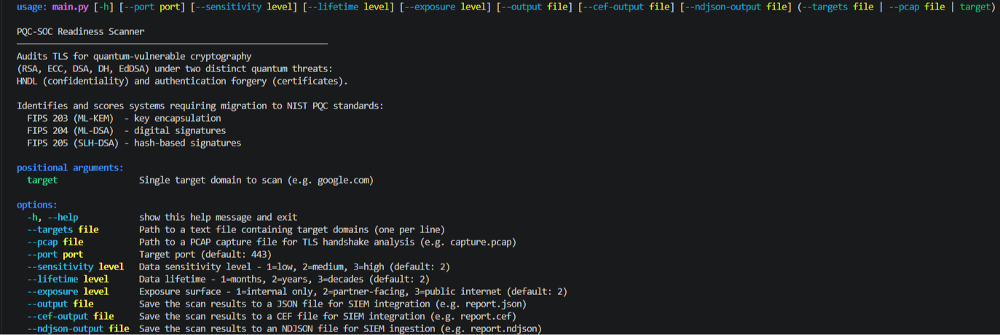

# PQC-SOC Readiness Scanner
 
> **Q-Day isn't the beginning of the threat. It's the end of the grace period.**
 
[](LICENSE)
[](https://www.python.org/)
[](https://github.com/surendrababu-sec/pqc-soc-readiness/tags)
[](https://github.com/surendrababu-sec/pqc-soc-readiness)
[](https://csrc.nist.gov/projects/post-quantum-cryptography)
[](https://github.com/surendrababu-sec/pqc-soc-readiness)

An independent research project and open-source Python tool auditing organisations' public-facing TLS endpoints and network captures for quantum-vulnerable cryptography. The scanner measures two distinct quantum threats - Harvest-Now, Decrypt-Later (HNDL) on the confidentiality side, and authentication forgery exposure on the certificate side, and scores both using the same model, labelled by the threat each finding actually represents.
 
Every vulnerable finding traces back to a specific NIST standard, a documented threat, and a weighted risk score the analyst can interrogate.
 
---
 
## Demo

https://github.com/user-attachments/assets/18e8d2fb-a9d0-410a-a32b-2e4e65a16228

A certificate scan of google.com, then the 10 November list of 300 hostnames. 299 answered and one failed. Those 299 findings are separate Splunk events: 287 scored 66.67 and 12 scored 53.33.

[Same file in the repository](assets/pqc-soc-demo.mp4).
 
---
 
## Table of Contents
 
- [The Problem](#the-problem)
- [What This Does](#what-this-does)
- [How It Works](#how-it-works)
- [The Quantum Exposure Scoring Model](#the-quantum-exposure-scoring-model)
- [Installation](#installation)
- [Usage](#usage)
- [Sample Output](#sample-output)
- [Research Foundation](#research-foundation)
- [Current State](#current-state)
- [Repository Structure](#repository-structure)
- [Roadmap](#roadmap)
- [Manuscript](#manuscript)
- [How to Cite](#how-to-cite)
- [Contributing](#contributing)
- [License](#license)
- [Author](#author)
  
---
 
## The Problem
 
Most organisations assume their encryption is secure. It isn't, not against what's coming.
 
The cryptography protecting healthcare records, financial transactions, government communications, and critical infrastructure today relies on two mathematical problems - integer factorisation (RSA) and the discrete logarithm (Diffie-Hellman, DSA, and elliptic-curve variants such as ECDSA and ECDHE) - that a sufficiently powerful quantum computer will solve using Shor's algorithm. Nation-state adversaries are already harvesting encrypted traffic today, archiving it for the day quantum capability arrives. For data with long-term sensitivity, the compromise is **already happening** - silently - even though the decryption hasn't yet.
 
NIST finalised the post-quantum replacements in 2024 (FIPS 203, 204, 205). Migration must begin now. But organisations cannot migrate what they cannot see. Most have no inventory of where their quantum-vulnerable cryptography lives.
 
**This project is the diagnostic instrument for that migration.**

Two distinct quantum threats are in scope: HNDL, which threatens confidentiality, and authentication forgery, which threatens the certificate the server presents. The scanner measures and scores both.
 
### Threat Model: HNDL
 
| Property | Implication |
|----------|-------------|
| Attack happens **today** | Encrypted traffic is intercepted and archived now. No alarms, no detection |
| Decryption happens **later** | Adversary waits for sufficient quantum capability to arrive |
| Affects **long-lived data** | Patient records, financial transactions, IP, classified material |
| Mitigation requires **migration**, not just monitoring | Defenders cannot retroactively unencrypt what is already harvested |
 
HNDL inverts the usual security calculus: the longer the data's sensitivity lifetime, the more urgent the migration, even if Q-Day itself is years away.

### Threat Model: Authentication Forgery

A certificate's public key is not secret. It is broadcast on every handshake and logged permanently in Certificate Transparency. There is nothing to harvest, because nothing is hidden. What breaks once a quantum computer can solve the underlying problem is the ability to derive the private signing key from that public key, allowing an adversary to impersonate the server for as long as the certificate remains valid.

| Property | HNDL (confidentiality) | Authentication forgery |
|----------|------------------------|-------------------------|
| What's at risk | Past session keys | Future signatures |
| Attack timing | Retroactive | Prospective |
| Requires harvesting today? | Yes | No. The public key is already public |
| Where it shows up | Key exchange (ECDHE, RSA key transport, DH) | Certificates (RSA, ECDSA, EdDSA) |
| What replaces it | ML-KEM (FIPS 203), often hybrid at first | ML-DSA (FIPS 204) or SLH-DSA (FIPS 205) |

The scanner scores both threats using the same four-factor model, but labels each vulnerable finding with the threat it actually represents, `confidentiality_harvest` for a key exchange, `signature_forgery` for a classical leaf, so the migration advice and rationale never conflate the two.

A finding is `pq_safe`, severity INFO, and unscored only when both sides of the certificate check are post-quantum, or when a captured handshake is ML-KEM or a hybrid that includes it. A post-quantum leaf signed by a classical issuer is not that case. It is `issuer_classical`, severity NOT-SCORED, and it is not safe. The issuer's key size is not in the certificate, so no number is invented.

---
 
## What This Does
 
The scanner operates in three ways: one hostname, a file of hostnames, or a packet capture.
 
**Certificate mode** connects to a live TLS endpoint, default port 443, and reads the certificate it is offered. It reads two object identifiers.

- The leaf public-key algorithm. This is the server's own key.
- The signature algorithm on that certificate. This is the algorithm the issuer used to sign the leaf. It is not a walk of the rest of the chain.

ML-DSA and SLH-DSA are recognised from the NIST OIDs in FIPS 204 and FIPS 205. The same OID is used for a subject public key and for a signature. Classical names cover RSA, ECDSA, EdDSA, finite-field Diffie-Hellman, DSA, and the usual RSA and ECDSA signature OIDs, including SHA-1 with RSA where it still appears.

| Leaf key | Issuer signature | Label | Scored? |
|----------|------------------|-------|---------|
| Classical | Classical | `signature_forgery` | Yes |
| Classical | Post-quantum | `signature_forgery` | Yes. The leaf is still classical |
| Post-quantum | Classical | `issuer_classical` | No. Not safe. Severity NOT-SCORED |
| Post-quantum | Post-quantum | `pq_safe` | No. Severity INFO |

Rows 2, 3, and 4 were checked on certificates generated locally with OpenSSL. Those certificates, and their private keys, are not in this repository. Certificate mode does not look at the key exchange. A host can be classical here and hybrid in a handshake. Results appear in the terminal with colour-coded severity, and can be saved as JSON, CEF, or NDJSON.

**PCAP mode** reads a network capture, reconstructs TLS handshake sessions, and scores the key exchange, which is the HNDL side. It does not score the certificate's forgery exposure. For that, run certificate mode against the same host. One finding is kept per server endpoint, whether or not that endpoint was vulnerable.

For TLS 1.3, if the Client Hello list is present and the Server Hello named a group that is in the local registry, that group is the one that is classified. If the Server Hello named nothing, or named a group that is not in the registry, the scanner falls back to the client's offer. The table's Server Hello column is there for this reason: `Yes` when that handshake was captured, `No, client offer only` when it was not.

Key sizes are resolved with algorithm-aware precision. The certificate in the capture is not used as the elliptic-curve size. In ECDHE the certificate handles authentication, not key exchange.

- **ECC key exchange.** The size comes from the TLS group. When the Server Hello KeyShare names a group and that group has a size, that size is used (`negotiated_group`). Otherwise the scanner takes the smallest classical size among the ECC and hybrid groups in the Client Hello (`supported_group`). A hybrid contributes its classical half only. If no group can be read, the size falls back to 256 bits, P-256 (`modal_baseline`). That figure is the scanner's own assumption. It is not a published measurement.
- **RSA key transport.** The certificate is the key-establishment key, and only in TLS 1.2. The scanner uses a certificate from the capture if one was seen (`pcap_certificate`). If not, it opens a short live connection and reads the key size there (`live_fetch`). That live certificate can differ from the one that was in use when the capture was taken. If the live read fails, the size is set to 2048 (`modal_baseline`).
- **Finite-field DH and DSA.** The risk contribution does not depend on size. When the capture does not yield one, the size is left empty and the source is still `modal_baseline`.

A hybrid name such as `X25519MLKEM768` is stored as `ECC+ML-KEM`. The session is labelled `pq_safe` and is not scored. The reason text says the classical half is still vulnerable to Shor's algorithm, and that confidentiality depends on the combiner specified for that group. The scanner trusts the group name. It does not check that the implementation used that combiner. A pure ML-KEM group is also `pq_safe`.

The scanner reads the Client Hello and the Server Hello. It does not parse `ServerKeyExchange`, so a TLS 1.2 elliptic-curve session does not get the server's chosen group from that message. It falls through the same size rule as any other session with no usable KeyShare size.

On the console, migration text is printed once per algorithm, and only for sessions that were scored as vulnerable. In the JSON, CEF, and NDJSON files, every finding keeps its own advice.

The scanner is TLS, on the port you pass, default 443. It does not cover SSH, IPsec, S/MIME, or code signing, and it does not walk the chain above the signature on the leaf.
 
---
 
## How It Works
 
```
┌──────────────────────────────────────────────────────────────┐
│  INGESTION                                                   │
│  Live TLS endpoints  ·  PCAP captures  ·  File of targets    │
└─────────────────────────────┬────────────────────────────────┘
                              ▼
┌──────────────────────────────────────────────────────────────┐
│  CRYPTOGRAPHIC ANALYSIS                                      │
│  Algorithm family  ·  Key size  ·  Cipher suite  ·  Groups   │
└─────────────────────────────┬────────────────────────────────┘
                              ▼
┌──────────────────────────────────────────────────────────────┐
│  QUANTUM RISK ENGINE                                         │
│  Label  ·  Quantum exposure score, where a classical key     │
│  remains  ·   NIST target  ·  Reason  ·  Advice              │
└─────────────────────────────┬────────────────────────────────┘
                              ▼
┌──────────────────────────────────────────────────────────────┐
│  REPORTING                                                   │
│  Colour-coded CLI  ·  JSON  ·  CEF  ·  NDJSON                │
└──────────────────────────────────────────────────────────────┘
```
 
**Detection targets:** RSA, ECC (ECDHE, ECDSA), finite-field Diffie-Hellman, DSA, EdDSA, and post-quantum recognition for ML-KEM, ML-DSA, SLH-DSA, and hybrid groups such as `X25519MLKEM768`.
 
**Recommendation targets:** FIPS 203 (ML-KEM), FIPS 204 (ML-DSA), FIPS 205 (SLH-DSA), with hybrid mode guidance during the transition period.
 
---
 
## The Quantum Exposure Scoring Model
 
This is the original research contribution at the heart of the scanner. Rather than a binary vulnerable/not-vulnerable flag, each vulnerable finding receives a weighted exposure score that reflects the urgency of migration in context. The same four-factor model scores both quantum threats - confidentiality and authentication forgery. The formula is identical for both. What changes is the label attached to each finding, and that label is what determines how the score should be read.

`pq_safe` findings sit outside this scoring pipeline. Severity INFO, no numeric score, because there is no classical key to score. `issuer_classical` also sits outside the formula, but it is not safe: severity NOT-SCORED, and the finding says the issuer's signature is still classical. The audit trail still records the algorithm and the NIST text.

This model was developed for this project. It orders migration work. It is not a vulnerability standard, and it is not CVSS. The weights are a default. They were not fitted to incident data. The derivation belongs in the forthcoming arXiv preprint. What follows is what the code does.
 
```
Quantum Exposure Score =
 
  [ (0.4 × algorithm_risk) + (0.2 × data_sensitivity) + (0.2 × data_lifetime) + (0.2 × exposure_surface) ]
  ────────────────────────────────────────────────────────────────────────────────────────────────────────  × 100
                                            max_possible_score
```

`max_possible_score` is read from [`scanner/knowledge/quantum_exposure_rubric.yaml`](scanner/knowledge/quantum_exposure_rubric.yaml). With every factor at its maximum of 3, that value is 3. Change the YAML and the normaliser follows it. The risk bands are in `scanner/modules/risk_engine.py`.
 
**Algorithm risk** is determined by the cryptographic family and key size:
 
| Algorithm | Key / Curve | Risk Score | Rationale |
|-----------|-------------|------------|-----------|
| RSA | < 2048 bits | 3 | Immediately at risk. Act now |
| RSA | 2048 bits | 2 | Standard deployment. Medium urgency |
| RSA | > 2048 bits | 1 | Larger key. Still vulnerable, lower urgency |
| ECC | < 256 bits | 3 | Small curve. Act immediately |
| ECC | 256 bits (P-256, secp256r1, X25519) | 2 | Standard deployment. Medium urgency |
| ECC | > 256 bits (e.g. secp384r1) | 1 | Larger curve. Still vulnerable, lower urgency |
| EdDSA (Ed25519) | ~128-bit security | 2 | Comparable security level to P-256 |
| EdDSA (Ed448) | ~224-bit security | 1 | Higher security level than Ed25519. Marginal breathing room |
| DH / DSA | Any | 2 | Vulnerable to Shor. Medium urgency |
| ML-KEM / ML-DSA / SLH-DSA | Any parameter set | not scored | `pq_safe` when the check is fully post-quantum. `issuer_classical` when a post-quantum leaf still has a classical issuer signature |
 
**Context factors** - each rated 1 (low) to 3 (high). The scanner does not infer them from the hostname. You pass them.
 
| Factor | 1 | 2 | 3 |
|--------|---|---|---|
| `data_sensitivity` | Public data | Internal use | Highly sensitive |
| `data_lifetime` | Months | Years | Decades |
| `exposure_surface` | Internal only | Partner-facing | Public internet |
 
All three default to 2, a fair middle-ground assumption when context is not specified. Override them with `--sensitivity`, `--lifetime`, and `--exposure`. Those defaults are why a private address and a public site can receive the same score. The capture does not tell the scanner how sensitive the data is.
 
**Severity thresholds:**
 
| Score | Severity | Suggested Action |
|-------|----------|-----------------|
| ≥ 75 | CRITICAL | Act immediately |
| 50 to < 75 | HIGH | Plan this quarter |
| 25 to < 50 | MEDIUM | On the roadmap |
| < 25 | LOW | Monitor |

> INFO and NOT-SCORED sit outside this table. INFO is a fully post-quantum finding. NOT-SCORED is a post-quantum leaf with a classical issuer signature. In a CEF file the numbers are CRITICAL 10, HIGH 7, NOT-SCORED 5, MEDIUM 4, LOW 1, INFO 0. The 5 is deliberate, so a not-scored finding is not stored as a safe one.

With the defaults, algorithm risk 2 scores 66.67 and algorithm risk 1 scores 53.33. Both are HIGH. RSA-2048 and P-256 share 66.67. RSA-4096 and P-384 share 53.33. The number can match while the algorithm, the advice, and the reason do not. Read the label.

An ML-DSA-65 signature is 3,309 bytes, against about 64 bytes for an ECDSA P-256 signature. The advice for a P-256 certificate says so. SLH-DSA is the alternative where the assurance is meant to rest on a hash function rather than a lattice problem.

The weights and max values live in the YAML, auditable independently of the code. The algorithm risk classification and the severity thresholds are held in the scanner's Python modules.
 
---
 
## Installation
 
```bash
git clone https://github.com/surendrababu-sec/pqc-soc-readiness.git
cd pqc-soc-readiness
 
# Create and activate a virtual environment
python -m venv venv
venv\Scripts\activate      # Windows
source venv/bin/activate   # macOS / Linux
 
pip install -r requirements.txt
```
 
**Keep up to date:**
 
```bash
git pull
pip install -r requirements.txt
```

The commands below are run from the repository root. `python scanner/main.py` works from there, because Python puts the `scanner/` directory on the module path. `cd scanner` and then `python main.py` also works.
 
---
 
## Usage
 
### Scan a single TLS endpoint
 
```bash
python scanner/main.py google.com
```
 
### Scan with a custom risk context
 
When you know the sensitivity of the data or the exposure of the endpoint, tell the scanner. It adjusts the quantum exposure score accordingly:
 
```bash
python scanner/main.py nhs.uk --sensitivity 3 --lifetime 3 --exposure 3
```
 
> `--sensitivity 3` = highly sensitive data (patient records, financial data)  
> `--lifetime 3` = data must stay secret for decades  
> `--exposure 3` = public-facing endpoint
 
### Scan on a non-standard port
 
```bash
python scanner/main.py example.com --port 8443
```
 
### Scan multiple targets from a file
 
```bash
python scanner/main.py --targets scanner/uk_sectoral_targets.txt
```
 
> `uk_sectoral_targets.txt` contains one domain per line. Edit it with your own targets. The file shipped here has 300 domains.
 
### PCAP handshake analysis
 
The scanner reads a capture from disk and takes the key size from the handshake. The WRCCDC qualifications file used for the sample below is not in the clone. `scanner/test_captures/` is gitignored. Pass the path of a capture you have:

```bash
python scanner/main.py --pcap capture.pcap
```
 
It reconstructs TLS sessions from the capture, identifies the cipher suites and key exchange groups, and produces a scored finding for each unique server endpoint. On the console, migration advice is shown once per algorithm type, not once per session.
 
### Save results as a JSON report
 
```bash
python scanner/main.py google.com --output report.json
 
python scanner/main.py --pcap capture.pcap --output pcap_report.json
```
 
> Reports save automatically to `scanner/output/` with a timestamp in the filename, so scans never overwrite each other.

The file is the aggregate report: scan metadata, every finding in urgency order, and the hosts that failed, with a reason. Keep it. Do not point Splunk at it. Pretty-printed JSON is one event, because a line breaker has nothing to split on.

A single `scan_id` is generated at the start of the run. It is written into the JSON metadata and onto every NDJSON line from that run. That is the join between the two files. The CEF lines do not carry it.

### Save results as a CEF file for SIEM ingestion

CEF (Common Event Format) is the text format ArcSight defined, and other products can accept it. It can be requested alongside or instead of JSON:

```bash
python scanner/main.py google.com --cef-output report.cef

python scanner/main.py --pcap capture.pcap --output report.json --cef-output report.cef
```

`msg` is last, because it is free text. On Splunk Enterprise 10.4.3, values that contain spaces, such as `FIPS 203 (ML-KEM)`, were parsed with the CEF Extraction Add-on (Igor Sher, Splunkbase), sourcetype `cefevents`. Without a parser that understands CEF, a value stops at the first space. These lines do not carry `rt=` or `end=`, so Splunk dates them at the time it indexes them. The scan time is `scan_timestamp` on the NDJSON line. No other SIEM was tried. Severity 7 is HIGH. NOT-SCORED is 5.

### Save results as NDJSON for SIEM ingestion

NDJSON is the file to give Splunk. One JSON object per line. The scan context is written first, then the finding: `scan_id`, `scan_timestamp` in UTC with a `Z`, `scanner_version`, and the three context values.

```bash
python scanner/main.py google.com --ndjson-output report.ndjson

python scanner/main.py --pcap capture.pcap --output report.json --cef-output report.cef --ndjson-output report.ndjson
```

The file is written with LF line endings even on Windows. This stanza was enough. Sourcetype name `pqc_ndjson`. No field-extraction regex.

```ini
[pqc_ndjson]
SHOULD_LINEMERGE = false
LINE_BREAKER = ([\r\n]+)
KV_MODE = json
TRUNCATE = 10000
```

The 47-session capture ingested as 47 events. The 300-hostname certificate run ingested as 300 events under the same sourcetype. In a PCAP line the finding also contains a field called `source`, set to `pcap_handshake`. Splunk already uses `source` for the filename. Filter on `sourcetype` or `target`. The NDJSON name for the NIST string is `nist_standard`. The CEF name is `nistStandard`.

A run of v0.2 writes `scanner_version` 0.2 in the JSON report, the NDJSON line, and the CEF header.
 
### Show all available options
 
```bash
python scanner/main.py --help
```


 
---
 
## Sample Output

Re-run on 5 November 2026. Same results as the earlier runs of these three inputs. A `scan_id` is new on every invocation, so the identifier from an older file is not repeated here.

### Certificate scan - google.com
 
```
╭─────────────────────────────────────────────────────────────╮
│ PQC-SOC Readiness Scanner - Target: google.com              │
╰─────────────────────────────────────────────────────────────╯
┏━━━━━━━━━━━━━━━━━┳━━━━━━━━━━━━━━━━━┳━━━━━━━━━━━━━━━┳━━━━━━━━━━━━━━━━━━━━━━━━━━┳━━━━━━━━━━━━━━━━━━━━━━━━━━━━━━━━━━━━━━━━┳━━━━━━━━━━━━━━━┳━━━━━━━━━━━━━━━━━━━━━━━━┳━━━━━━━━━━┳━━━━━━━━━━━━━━━━━━━┓
┃ Target          ┃ Algorithm       ┃ Key Size      ┃ Vulnerable               ┃ Issuer                                 ┃ Expires       ┃ Quantum Exposure Score ┃ Severity ┃ NIST Standard     ┃
┡━━━━━━━━━━━━━━━━━╇━━━━━━━━━━━━━━━━━╇━━━━━━━━━━━━━━━╇━━━━━━━━━━━━━━━━━━━━━━━━━━╇━━━━━━━━━━━━━━━━━━━━━━━━━━━━━━━━━━━━━━━━╇━━━━━━━━━━━━━━━╇━━━━━━━━━━━━━━━━━━━━━━━━╇━━━━━━━━━━╇━━━━━━━━━━━━━━━━━━━┩
│ google.com      │ ECC (secp256r1) │ 256 bits      │ YES - Quantum Vulnerable │ CN=WE2,O=Google Trust Services,C=US    │ 30 Dec 2026   │ 66.67                  │ HIGH     │ FIPS 204 (ML-DSA) │
└─────────────────┴─────────────────┴───────────────┴──────────────────────────┴────────────────────────────────────────┴───────────────┴────────────────────────┴──────────┴───────────────────┘
╭────────────────────────────────────────────────────── Migration Advice ───────────────────────────────────────────────────────╮
│ Migrate certificate signatures from ECDSA to ML-DSA-65 (FIPS 204) - the post-quantum equivalent at the P-256 security level.  │
│ Note the operational impact: ML-DSA-65 signatures are approximately 50 times larger than ECDSA P-256 (3,309 versus 64 bytes), │
│ with corresponding handshake overhead. Deploy in hybrid mode during transition. For environments requiring conservative       │
│ assurance based on hash function security rather than lattice hardness, SLH-DSA (FIPS 205) is the approved alternative.       │
╰───────────────────────────────────────────────────────────────────────────────────────────────────────────────────────────────╯
╭────────────────────────────────────────────────────── Rationale ──────────────────────────────────────────────────────────────╮
│ ECC (secp256r1) is vulnerable to Shor's algorithm. A quantum computer capable of breaking this signature scheme could derive  │
│ the private signing key from the public key, and with the private key impersonate this endpoint for as long as the certificate│
│ remains valid - this is a forward-looking authentication risk. Quantum exposure score: 66.67/100 (HIGH).                      │
╰───────────────────────────────────────────────────────────────────────────────────────────────────────────────────────────────╯
```

### A file of hostnames

`python scanner/main.py --targets scanner/uk_sectoral_targets.txt`

Each host that answers is printed with the same table as a single-host scan. After the last host, the summary. Every answered certificate was a classical leaf with a classical issuer signature, so every finding was `signature_forgery` and HIGH.

```
Scan complete.
Total in file : 300
Successfully scanned: 300
Vulnerable    : 300
Not vulnerable: 0
Failed to scan: 0
```

| Score | Count | What they were |
|-------|-------|----------------|
| 66.67 | 287 | 211 RSA-2048, 76 secp256r1 |
| 53.33 | 13 | 11 RSA-4096, 2 secp384r1 |

This printed summary is the 5 November run, which is the one the manuscript uses. The demo at the top is a later pass, on 10 November: 299 answered, one failed, 287 at 66.67 and 12 at 53.33.

Context values were left at 2. No finding was `issuer_classical` or `pq_safe`. The scan did not walk the chain above the issuer signature, and it did not look at the key exchange. The list is a public-hostname list, not a measure of whether those organisations have a migration plan. A CDN certificate is the certificate the scanner sees.
 
### PCAP analysis - network capture (47 sessions detected)

Western Regional Collegiate Cyber Defense Competition qualifications capture, file `wrccdc-quals.2026-02-07.0900110000.pcap`, 7 February 2026. The file is not in the clone. Forty-six sessions scored 66.67. One, `52.123.255.143:443`, was a 384-bit group in the KeyShare and scored 53.33. None was ML-KEM or a hybrid. This run had ECC and finite-field DH, so those are the two advice panels. 
 
```
╭────────────────────────────────────────────────────────────────────────────╮
│ PQC-SOC Readiness Scanner - PCAP Handshake Analysis                        │
╰────────────────────────────────────────────────────────────────────────────╯
┏━━━━━━━━━━━━━━━━━━━━━━━━┳━━━━━━━━━━━━━━━━━━━━━━━━━━┳━━━━━━━━━━━━━━━━━━┳━━━━━━━━━━━━━━━━━━━━━━━━━━━━━━━━━━━━━━━━━━┳━━━━━━━━━━━━━━━━━━━━━━━━┳━━━━━━━━━━━━━━━━┳━━━━━━━━━━━━━━━━━━━━━━━━━━━━━━┳━━━━━━━━━━━━━━━━━━━━━━━━━━━━━━━┓
┃ Server Endpoint        ┃ Client IP                ┃ Algorithm        ┃ Cipher Suite                             ┃ Quantum Exposure Score ┃ Severity       ┃ NIST Standard                ┃ Server Hello                  ┃
┡━━━━━━━━━━━━━━━━━━━━━━━━╇━━━━━━━━━━━━━━━━━━━━━━━━━━╇━━━━━━━━━━━━━━━━━━╇━━━━━━━━━━━━━━━━━━━━━━━━━━━━━━━━━━━━━━━━━━╇━━━━━━━━━━━━━━━━━━━━━━━━╇━━━━━━━━━━━━━━━━╇━━━━━━━━━━━━━━━━━━━━━━━━━━━━━━╇━━━━━━━━━━━━━━━━━━━━━━━━━━━━━━━┩
│ 20.190.151.9:443       │ 10.100.111.14            │ ECC              │ TLS_ECDHE_RSA_WITH_AES_256_GCM_SHA384    │ 66.67                  │ HIGH           │ FIPS 203 (ML-KEM)            │ Yes                           │
│ 18.197.12.165:443      │ 10.100.101.14            │ ECC              │ TLS_ECDHE_RSA_WITH_AES_128_GCM_SHA256    │ 66.67                  │ HIGH           │ FIPS 203 (ML-KEM)            │ Yes                           │
│ 4.150.155.223:443      │ 10.100.104.14            │ ECC              │ TLS_ECDHE_RSA_WITH_AES_128_GCM_SHA256    │ 66.67                  │ HIGH           │ FIPS 203 (ML-KEM)            │ Yes                           │
│ 104.21.46.33:443       │ 10.100.122.28            │ ECC              │ TLS 1.3 with ECC                         │ 66.67                  │ HIGH           │ FIPS 203 (ML-KEM)            │ Yes                           │
│ 40.126.62.131:443      │ 10.100.101.28            │ ECC              │ TLS_ECDHE_RSA_WITH_AES_256_GCM_SHA384    │ 66.67                  │ HIGH           │ FIPS 203 (ML-KEM)            │ Yes                           │
│ 172.67.223.33:443      │ 10.100.103.28            │ ECC              │ TLS 1.3 with ECC                         │ 66.67                  │ HIGH           │ FIPS 203 (ML-KEM)            │ Yes                           │
│ 104.208.16.92:443      │ 10.100.111.14            │ ECC              │ TLS_ECDHE_ECDSA_WITH_AES_256_GCM_SHA384  │ 66.67                  │ HIGH           │ FIPS 203 (ML-KEM)            │ No, client offer only         │
│ 10.100.101.240:443     │ 10.237.77.58             │ ECC              │ TLS 1.3 with ECC                         │ 66.67                  │ HIGH           │ FIPS 203 (ML-KEM)            │ Yes                           │
│ 10.100.102.240:443     │ 10.207.168.91            │ ECC              │ TLS 1.3 with ECC                         │ 66.67                  │ HIGH           │ FIPS 203 (ML-KEM)            │ Yes                           │
│ 10.100.103.240:443     │ 10.237.77.58             │ ECC              │ TLS 1.3 with ECC                         │ 66.67                  │ HIGH           │ FIPS 203 (ML-KEM)            │ Yes                           │
│ 52.183.220.149:443     │ 10.100.104.14            │ ECC              │ TLS_ECDHE_ECDSA_WITH_AES_256_GCM_SHA384  │ 66.67                  │ HIGH           │ FIPS 203 (ML-KEM)            │ No, client offer only         │
│ 52.182.143.211:443     │ 10.100.104.14            │ ECC              │ TLS_ECDHE_ECDSA_WITH_AES_256_GCM_SHA384  │ 66.67                  │ HIGH           │ FIPS 203 (ML-KEM)            │ No, client offer only         │
│ 10.100.104.240:443     │ 10.237.77.58             │ ECC              │ TLS 1.3 with ECC                         │ 66.67                  │ HIGH           │ FIPS 203 (ML-KEM)            │ Yes                           │
│ 10.100.105.240:443     │ 10.237.77.58             │ ECC              │ TLS 1.3 with ECC                         │ 66.67                  │ HIGH           │ FIPS 203 (ML-KEM)            │ Yes                           │
│ 10.100.106.240:443     │ 10.237.77.58             │ ECC              │ TLS 1.3 with ECC                         │ 66.67                  │ HIGH           │ FIPS 203 (ML-KEM)            │ Yes                           │
│ 10.100.107.240:443     │ 10.205.123.208           │ ECC              │ TLS 1.3 with ECC                         │ 66.67                  │ HIGH           │ FIPS 203 (ML-KEM)            │ Yes                           │
│ 10.100.108.240:443     │ 10.205.123.208           │ ECC              │ TLS 1.3 with ECC                         │ 66.67                  │ HIGH           │ FIPS 203 (ML-KEM)            │ Yes                           │
│ 13.107.246.69:443      │ 10.100.101.28            │ ECC              │ TLS 1.3 with ECC                         │ 66.67                  │ HIGH           │ FIPS 203 (ML-KEM)            │ Yes                           │
│ 10.100.109.240:443     │ 10.207.168.91            │ ECC              │ TLS 1.3 with ECC                         │ 66.67                  │ HIGH           │ FIPS 203 (ML-KEM)            │ Yes                           │
│ 10.100.111.240:443     │ 10.207.168.91            │ ECC              │ TLS 1.3 with ECC                         │ 66.67                  │ HIGH           │ FIPS 203 (ML-KEM)            │ Yes                           │
│ 10.100.112.240:443     │ 10.207.168.91            │ ECC              │ TLS 1.3 with ECC                         │ 66.67                  │ HIGH           │ FIPS 203 (ML-KEM)            │ Yes                           │
│ 10.100.110.240:443     │ 10.205.123.208           │ ECC              │ TLS 1.3 with ECC                         │ 66.67                  │ HIGH           │ FIPS 203 (ML-KEM)            │ Yes                           │
│ 10.100.114.240:443     │ 10.207.168.91            │ ECC              │ TLS 1.3 with ECC                         │ 66.67                  │ HIGH           │ FIPS 203 (ML-KEM)            │ Yes                           │
│ 10.100.113.240:443     │ 10.224.226.113           │ ECC              │ TLS 1.3 with ECC                         │ 66.67                  │ HIGH           │ FIPS 203 (ML-KEM)            │ Yes                           │
│ 20.190.151.7:443       │ 10.100.104.14            │ ECC              │ TLS_ECDHE_ECDSA_WITH_AES_256_GCM_SHA384  │ 66.67                  │ HIGH           │ FIPS 203 (ML-KEM)            │ No, client offer only         │
│ 10.100.115.240:443     │ 10.224.226.113           │ ECC              │ TLS 1.3 with ECC                         │ 66.67                  │ HIGH           │ FIPS 203 (ML-KEM)            │ Yes                           │
│ 10.100.116.240:443     │ 10.237.77.58             │ ECC              │ TLS 1.3 with ECC                         │ 66.67                  │ HIGH           │ FIPS 203 (ML-KEM)            │ Yes                           │
│ 10.100.119.240:443     │ 10.205.123.208           │ ECC              │ TLS 1.3 with ECC                         │ 66.67                  │ HIGH           │ FIPS 203 (ML-KEM)            │ Yes                           │
│ 10.100.117.240:443     │ 10.224.226.113           │ ECC              │ TLS 1.3 with ECC                         │ 66.67                  │ HIGH           │ FIPS 203 (ML-KEM)            │ Yes                           │
│ 10.100.121.240:443     │ 10.237.77.58             │ ECC              │ TLS 1.3 with ECC                         │ 66.67                  │ HIGH           │ FIPS 203 (ML-KEM)            │ Yes                           │
│ 10.100.120.240:443     │ 10.205.123.208           │ ECC              │ TLS 1.3 with ECC                         │ 66.67                  │ HIGH           │ FIPS 203 (ML-KEM)            │ Yes                           │
│ 10.100.123.240:443     │ 10.207.168.91            │ ECC              │ TLS 1.3 with ECC                         │ 66.67                  │ HIGH           │ FIPS 203 (ML-KEM)            │ Yes                           │
│ 10.100.118.240:443     │ 10.224.226.113           │ ECC              │ TLS 1.3 with ECC                         │ 66.67                  │ HIGH           │ FIPS 203 (ML-KEM)            │ Yes                           │
│ 10.100.124.240:443     │ 10.207.168.91            │ ECC              │ TLS 1.3 with ECC                         │ 66.67                  │ HIGH           │ FIPS 203 (ML-KEM)            │ Yes                           │
│ 10.100.125.240:443     │ 10.207.168.91            │ ECC              │ TLS 1.3 with ECC                         │ 66.67                  │ HIGH           │ FIPS 203 (ML-KEM)            │ Yes                           │
│ 10.100.122.240:443     │ 10.224.226.113           │ ECC              │ TLS 1.3 with ECC                         │ 66.67                  │ HIGH           │ FIPS 203 (ML-KEM)            │ Yes                           │
│ 10.100.126.240:443     │ 10.207.168.91            │ ECC              │ TLS 1.3 with ECC                         │ 66.67                  │ HIGH           │ FIPS 203 (ML-KEM)            │ Yes                           │
│ 10.100.127.240:443     │ 10.237.77.58             │ ECC              │ TLS 1.3 with ECC                         │ 66.67                  │ HIGH           │ FIPS 203 (ML-KEM)            │ Yes                           │
│ 10.100.129.240:443     │ 10.237.77.58             │ ECC              │ TLS 1.3 with ECC                         │ 66.67                  │ HIGH           │ FIPS 203 (ML-KEM)            │ Yes                           │
│ 10.100.128.240:443     │ 10.205.123.208           │ ECC              │ TLS 1.3 with ECC                         │ 66.67                  │ HIGH           │ FIPS 203 (ML-KEM)            │ Yes                           │
│ 140.82.112.3:443       │ 10.100.116.16            │ ECC              │ TLS 1.3 with ECC                         │ 66.67                  │ HIGH           │ FIPS 203 (ML-KEM)            │ Yes                           │
│ 35.190.49.118:443      │ 10.100.102.14            │ ECC              │ TLS 1.3 with ECC                         │ 66.67                  │ HIGH           │ FIPS 203 (ML-KEM)            │ Yes                           │
│ 185.199.110.133:443    │ 10.100.102.14            │ ECC              │ TLS 1.3 with ECC                         │ 66.67                  │ HIGH           │ FIPS 203 (ML-KEM)            │ Yes                           │
│ 10.100.125.2:443       │ 10.2.1.5                 │ DH               │ TLS_DHE_RSA_WITH_3DES_EDE_CBC_SHA        │ 66.67                  │ HIGH           │ FIPS 203 (ML-KEM)            │ No, client offer only         │
│ 52.168.117.171:443     │ 10.100.126.14            │ ECC              │ TLS_ECDHE_RSA_WITH_AES_256_GCM_SHA384    │ 66.67                  │ HIGH           │ FIPS 203 (ML-KEM)            │ Yes                           │
│ 13.71.55.58:443        │ 10.100.126.14            │ ECC              │ TLS_ECDHE_ECDSA_WITH_AES_256_GCM_SHA384  │ 66.67                  │ HIGH           │ FIPS 203 (ML-KEM)            │ No, client offer only         │
│ 52.123.255.143:443     │ 10.100.127.22            │ ECC              │ TLS 1.3 with ECC                         │ 53.33                  │ HIGH           │ FIPS 203 (ML-KEM)            │ Yes                           │
└────────────────────────┴──────────────────────────┴──────────────────┴──────────────────────────────────────────┴────────────────────────┴────────────────┴──────────────────────────────┴───────────────────────────────┘
╭──────────────────────────────────────── Migration Advice - ECC ─────────────────────────────────────────╮
│ Migrate key exchange from ECDH to ML-KEM-768 (FIPS 203). Deploy in hybrid mode alongside X25519 during  │
│ transition, this is the X25519MLKEM768 pattern already in production at Google and Cloudflare since     │
│ 2024. Prioritise endpoints carrying long-lived or sensitive data first, as those are the primary        │
│ harvest-now-decrypt-later targets.                                                                      │
╰─────────────────────────────────────────────────────────────────────────────────────────────────────────╯
╭──────────────────────────────────────── Migration Advice - DH ──────────────────────────────────────────╮
│ Replace finite-field Diffie-Hellman (whether RFC 7919 FFDHE groups or legacy parameters) with ML-KEM-768│
│ (FIPS 203). Unlike elliptic curves, finite-field DH has no post-quantum variant, it must be replaced    │
│ entirely, not upgraded. Deploy ML-KEM in hybrid mode during transition. Legacy DH parameters carry      │
│ additional classical risk from small subgroup attacks - prioritise these endpoints.                     │
╰─────────────────────────────────────────────────────────────────────────────────────────────────────────╯

Scan complete.
Sessions analysed  : 47
Vulnerable         : 47
Hybrid PQC         : 0
Post-quantum safe  : 0
Unknown            : 0
```
 
`Server Hello` is `Yes` when that handshake was in the capture, and `No, client offer only` when it was not. The 53.33 row is the last data row.

One CEF line from that session, so the shape is visible:

```
CEF:0|PQC-SOC|Readiness Scanner|0.2|ECC|Quantum-vulnerable key exchange detected|7|target=52.123.255.143:443 algorithm=ECC score=53.33 threatCategory=confidentiality_harvest nistStandard=FIPS 203 (ML-KEM) msg=ECC is vulnerable to Shor's algorithm under the HNDL threat model. Session keys derived from this key exchange are at risk of retroactive decryption - traffic captured today can be decrypted once a sufficiently powerful quantum computer exists. Quantum exposure score: 53.33/100 (HIGH). Key size read directly from the group the server selected in the KeyShare extension.
```

One NDJSON line carries the same finding, plus `scan_id`, `scan_timestamp`, the three context values, `migration_advice`, and `rationale`. Those last two fields are long. The fields a search usually starts from are `target`, `algorithm`, `quantum_exposure_score`, `threat_category`, `key_size`, and `key_size_source`.
 
---
 
## Research Foundation
 
The scanner is built on a structured independent study of the mathematical foundations of post-quantum cryptography. The detection and scoring logic is original. The tool uses standard libraries for certificate parsing (`cryptography`) and packet reading (Scapy), but the quantum exposure scoring model, algorithm classification, and migration guidance are written from scratch and grounded in this research.
 
**Lattice-based cryptography**

- Polynomial rings of the form *R*<sub>q</sub> = ℤ<sub>q</sub>[x]/(x<sup>n</sup> + 1)
- Module Learning With Errors (MLWE) and the decisional variant (D-MLWE)
- Why no known quantum algorithm efficiently solves these problems, and why that matters for the long-term security of ML-KEM and ML-DSA
  
**CRYSTALS-Kyber (ML-KEM, FIPS 203)**

- Full key generation, encapsulation, and decapsulation construction
- IND-CPA → IND-CCA2 hardening via the Fujisaki-Okamoto transform
- Parameter sets (ML-KEM-512/768/1024) and their security/overhead trade-offs
- Why ML-KEM-768 is the recommended default for most deployments
  
**CRYSTALS-Dilithium (ML-DSA, FIPS 204)**

- Schnorr signature scheme foundations and the lattice adaptation
- Rejection sampling, HighBits/LowBits decomposition, hint vectors
- Full ML-DSA scheme construction: key generation, signing, verification, correctness argument
- Parameter sets (ML-DSA-44/65/87) - key and signature sizes at each level
- Why ML-DSA-65 signatures are approximately 50× larger than ECDSA P-256, and what that means operationally
  
**Classical cryptographic failure under Shor's algorithm**

- The mathematical basis for RSA and ECC vulnerability
- Quantum complexity of integer factorisation and the discrete logarithm
- Why doubling the classical key size does not help against a quantum adversary
  
**NIST PQC standardisation**

- FIPS 203 (ML-KEM) - key encapsulation
- FIPS 204 (ML-DSA) - digital signatures
- FIPS 205 (SLH-DSA) - hash-based signatures as a conservative alternative
- Hybrid deployment considerations during the transition period
  
Full structured notes:

- [`MONTH-1-NOTES.md`](MONTH-1-NOTES.md) covers the HNDL threat model, RSA/ECC quantum failure, NIST standardisation
- [`MONTH-2-NOTES.md`](MONTH-2-NOTES.md) covers the CRYSTALS-Kyber mathematical structure, ML-KEM construction
- [`MONTH-3-NOTES.md`](MONTH-3-NOTES.md) covers the CRYSTALS-Dilithium mathematical structure, ML-DSA construction
- [`RESEARCH-NOTES.md`](RESEARCH-NOTES.md) is the master index across all research notes
  
---
 
## Current State
 
Honesty matters more than ambition. Here is exactly where this project stands today:
 
| Component | State |
|-----------|-------|
| HNDL threat model formalisation | ✅ Complete |
| Mathematical foundations - CRYSTALS-Kyber (ML-KEM) | ✅ Complete |
| Mathematical foundations - CRYSTALS-Dilithium (ML-DSA) | ✅ Complete |
| NIST FIPS 203/204/205 study | ✅ Complete |
| Scanner architecture and design | ✅ Complete |
| TLS certificate detection - RSA, ECC, DSA, DH, EdDSA | ✅ Complete |
| Four-row check, leaf OID and issuer-signature OID | ✅ Complete |
| `issuer_classical`, NOT-SCORED, not safe | ✅ Complete |
| Multiple target scanning from file | ✅ Complete |
| Quantum exposure scoring engine | ✅ Complete - weighted 0-100 with configurable rubric. Null score for post-quantum and for `issuer_classical` |
| NIST migration recommendation engine | ✅ Complete - FIPS 203/204/205 mapped |
| Configurable risk context flags | ✅ Complete. Default 2, 2, 2 |
| JSON export for SIEM integration | ✅ Complete. Failed scans included, urgency-first ordering. Not a Splunk event source |
| CEF export | ✅ Complete. Checked on Splunk 10.4.3 with the CEF Extraction Add-on. No `scan_id`, and no scan time, on the line |
| NDJSON export | ✅ Complete. Checked on Splunk 10.4.3, `KV_MODE=json`, 47 events and 300 events |
| `scan_id` shared by the JSON report and the NDJSON lines | ✅ Complete. Not written to CEF |
| PCAP handshake analysis | ✅ Complete |
| Detection of hybrid PQC groups (X25519+ML-KEM, pure ML-KEM) | ✅ Complete. Labelled `pq_safe`, not scored |
| Hybrid PQC adoption reported as its own category | ✅ Complete |
| Dual quantum threat taxonomy (confidentiality vs authentication) | ✅ Complete |
| Algorithm-aware key size resolution from TLS groups | ✅ Complete. Five source labels |
| TLS 1.3 selected group used for classification and for the key size | ✅ Complete |
| Post-quantum finding differentiation (`pq_safe`, INFO) | ✅ Complete |
| Algorithm-specific migration advice, once per algorithm on the console | ✅ Complete |
| v0.1 tagged release | ✅ Released 14 July 2026 |
| v0.2 | ✅ Tagged November 2026 |
| arXiv manuscript | 🟡 In preparation |
 
✅ = complete · 🟡 = in progress · ⏳ = planned
 
---
 
## Repository Structure
 
```
pqc-soc-readiness/
├── scanner/
│   ├── modules/
│   │   ├── certificate_analyser.py   # Leaf OID and issuer-signature OID, four-row check
│   │   ├── risk_engine.py            # Quantum exposure score, severity, threat category, NIST text
│   │   ├── pcap_analyser.py          # Handshake parsing, selected group, key-size fallback
│   │   ├── ndjson_writer.py          # One JSON object per line, scan context first
│   │   └── cef_writer.py             # CEF output. Escaping, severity mapping, event building
│   ├── knowledge/
│   │   ├── quantum_exposure_rubric.yaml  # Scoring weights and max values - auditable
│   │   ├── nist_mappings.yaml            # NIST PQC migration sentences the tool prints
│   │   ├── cipher_suites.csv             # IANA TLS cipher suite registry
│   │   └── supported_groups.csv          # IANA TLS supported groups registry
│   ├── test_captures/                # Gitignored. Local captures, including the WRCCDC qualifications file
│   ├── testdata/                     # Gitignored. Test certificates only. Never commit a private key
│   ├── output/                       # Scan results. Created on a run, gitignored
│   ├── uk_sectoral_targets.txt       # 300 UK public hostnames, one per line
│   ├── test_pq_rationale.py          # Checks the three post-quantum rationale texts
│   └── main.py                       # CLI entry point
├── assets/
│   └── help_screenshot.png           # CLI --help output
│   └── pqc-soc-demo.mp4              # 10 November demo
├── MONTH-1-NOTES.md                  # Month 1 - HNDL threat model and foundations
├── MONTH-2-NOTES.md                  # Month 2 - CRYSTALS-Kyber mathematics
├── MONTH-3-NOTES.md                  # Month 3 - CRYSTALS-Dilithium mathematics
├── RESEARCH-NOTES.md                 # Master index across all research notes
├── requirements.txt                  # Python dependencies - pinned versions
├── LICENSE                           # MIT
└── README.md                         # This file
```
 
The `knowledge/` folder is kept as data, not code. Weights, mappings, and IANA registry data can be updated independently of the detection code, which matters as NIST guidance evolves. 
---
 
## Roadmap
 
This project is structured as a phased independent research programme. Current phase: **Phase 4 - arXiv preprint**.
 
**Phase 1 - Foundation** ✅ *Complete*

- Mathematical foundations of ML-KEM and ML-DSA
- HNDL threat model formalisation and scoring model design
- Scanner architecture
  
**Phase 2 - Detection and Risk Engine** ✅ *Complete*

- TLS endpoint probing and certificate analysis
- Multiple target scanning from file
- Quantum exposure scoring engine
- NIST migration recommendation engine
- Configurable risk context flags
- JSON export
  
**Phase 3 - Reporting and Network Analysis** ✅ *Complete (v0.1 released July 2026)*

- PCAP-based handshake analysis ✅
- Detection of hybrid PQC groups (X25519+ML-KEM, pure ML-KEM) ✅
- Dual quantum threat taxonomy - confidentiality vs authentication forgery ✅
- Algorithm-aware ECC key size resolution from TLS handshake groups ✅
- TLS 1.3 KeyShare extraction for exact negotiated group size ✅
- SIEM-ready CEF output ✅
- JSON report, failed scans included, urgency-first ordering ✅
- Post-quantum short-circuit (`pq_safe`, INFO) ✅
- Documentation pass for the v0.1 page ✅
  
**Phase 4 - arXiv preprint** 🟡 *In progress*

- NDJSON, and the Splunk 10.4.3 check ✅
- Four-row certificate check, leaf and issuer signature read separately ✅
- `issuer_classical` for a post-quantum leaf with a classical issuer signature ✅
- TLS 1.3 classification follows the server's selected group when the Client Hello list is present ✅
- Rationale text that does not claim a finding saw a certificate, or a combiner, it did not check ✅
- Tag v0.2 ✅
- arXiv preprint 🟡
  
---
 
## Manuscript
 
> **PQC-SOC Readiness: Auditing Organisations' Public-Facing TLS Endpoints and Network Captures for Quantum-Vulnerable Cryptography Under the HNDL and Authentication Forgery Threat Models**
>
> Surendra Babu Chilakaluru
>
> *Manuscript in preparation. Target: arXiv cs.CR, 2026.*
 
The manuscript documents the quantum exposure scoring model and its application to both threats, the four-row certificate check, the algorithm-aware key size rule for a capture, and two measurements. Certificate mode, 300 UK public hostnames, run on 5 November 2026: all 300 classical, 287 at 66.67 and 13 at 53.33. Packet-capture mode, 47 TLS sessions from the WRCCDC qualifications capture of 7 February 2026, run on the same day. That file is a competition capture, and it is not the same set of hosts as the 300.

The 300 hostnames are not a UK-wide rate. The scanner is the instrument. The paper is the research contribution. The score orders work.
 
---
 
## How to Cite
 
Until the manuscript is published, you may cite this repository:
 
```bibtex
@misc{surendrababu_pqc_soc_2026,
  author       = {Chilakaluru, Surendra Babu},
  title        = {PQC-SOC Readiness Scanner: Auditing Organisations' Public-Facing TLS Endpoints and Network
                  Captures for Quantum-Vulnerable Cryptography Under the HNDL and Authentication Forgery Threat Models},
  year         = {2026},
  howpublished = {\url{https://github.com/surendrababu-sec/pqc-soc-readiness}},
  note         = {Independent research project and open-source tool. v0.2 tagged November 2026. Manuscript in preparation.}
}
```
 
---
 
## Contributing
 
Feedback, issues, and pull requests are welcome, especially on the quantum exposure scoring model and its weights. If something is technically wrong, or you are working on a NIST PQC migration and want to compare notes, open an issue.
 
Things that would particularly help:

- A capture that actually negotiates ML-KEM or a hybrid group, so that path can be shown rather than only described
- A disagreement with the weights, stated against a finding
- A correction to a sentence in `nist_mappings.yaml`
- Testing the CEF or NDJSON output against your own SIEM environment
 
---
 
## License
 
Released under the [MIT License](LICENSE).
 
---
 
## Author
 
**Surendra Babu Chilakaluru**
 
MSc Information Security & Digital Forensics, with Distinction, University of East London. Independent researcher in post-quantum cryptography and security operations. Based in London, UK.
 
Connect: [LinkedIn](https://www.linkedin.com/in/surendra-babu-chilakaluru/) · [GitHub](https://github.com/surendrababu-sec)

Poster, Authentication for Quantum Networks, King's College London, June 2026. Talk accepted for BSides Newcastle, 28 November 2026: "Two quantum threats, one queue: what a SOC should migrate first."

---
 
*Independent research, conducted outside any academic programme, funded by the author's own time, and documented publicly with a full timestamped commit history from day one.*
